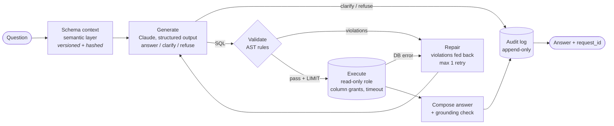
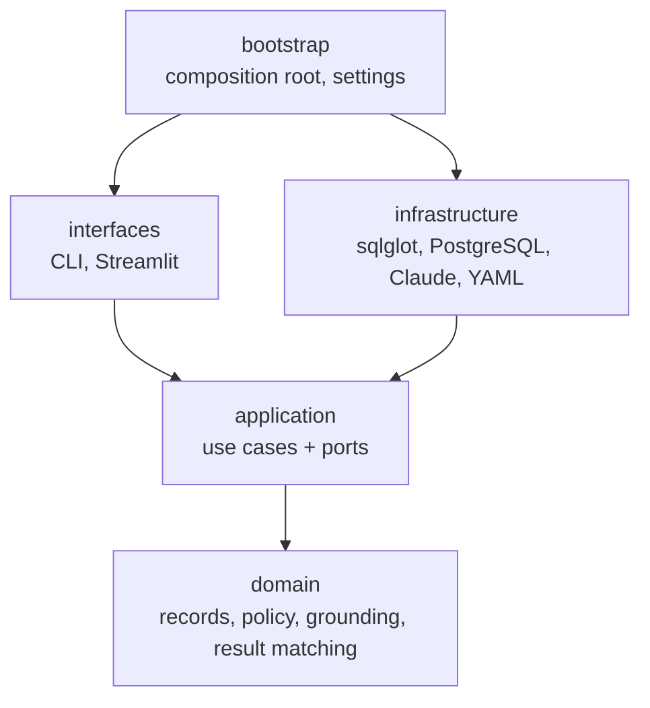

# Auditable Text-to-SQL

Ask questions about investment-portfolio data in plain English. Every answer can be traced, re-executed, and explained later.

This is a **reference implementation designed for production constraints** (least-privilege database access, deterministic validation, an append-only audit trail, measured accuracy). It is not a deployed product and has no production usage history. All data is synthetic.


---

## The problem

Connecting an LLM to a financial database is easy. Trusting the answer is the hard part:

- A query that runs is not necessarily the right query. The model can be confidently wrong.
- The model must not read data it shouldn't (client PII), write anything, or hang the database.
- Six months later, someone will ask *"why did the system say our AUM was $335M on that day?"*, and the answer has to be reproducible.
- Some questions should not be answered at all: ambiguous ones, ones the data can't support, requests for advice.

This project treats the model as an **untrusted SQL author**. Deterministic code decides what runs, the database enforces it a second time, and every step is recorded.

## How a question flows



Nothing reaches the user until the audit record is written. If the write fails, the request fails (**no audit, no answer**).

## Three independent layers of protection

| Layer | Where | What it stops | Tested by |
|---|---|---|---|
| **1. Static validation** | `SqlglotValidator`, on the parsed AST | Anything other than one `SELECT`; writes hidden in CTEs; `SELECT INTO`, `FOR UPDATE`; tables/columns outside the whitelist (including through aliases, subqueries, `LATERAL`, whole-row references, positional column aliases); dangerous or non-deterministic functions; system catalogs. Caps `LIMIT`. | 60 adversarial queries, each asserting the **specific rule** that must fire, plus 18 legitimate queries that must pass |
| **2. Database role** | PostgreSQL `nl2sql_reader` | Column-level `GRANT SELECT` on exposed columns only, read-only transactions by default, role-level `statement_timeout`, no access to the audit schema | Integration tests that **bypass the validator** and hit the database directly |
| **3. Runtime limits** | `PostgresExecutor` | Per-call `SET LOCAL statement_timeout`, `BEGIN READ ONLY`, fetches `max_rows + 1` to detect truncation | Integration tests |

Each layer is designed to hold if the one before it fails. For example, `SELECT c FROM clients c` (a whole-row reference that would include `tax_id`) is rejected by the validator as `R009_WHOLE_ROW_REFERENCE`, and *separately* by PostgreSQL with `permission denied`. Both are tested.

## Design decisions

**The semantic layer is the single source of truth.** [`config/semantic_layer.yaml`](config/semantic_layer.yaml) defines tables, columns, business definitions ("AUM = sum of market value on one date, excluding cash"), join paths, and what the data *cannot* answer. The model's context and the validator's whitelist are both derived from it. Columns marked `exposed: false` are never shown to the model and never allowed through. The database grants live in SQL, and an integration test fails if they drift from the YAML.

**The validator has its own column resolver instead of relying on `qualify()`.** sqlglot's `qualify()` is built to make queries runnable, not to act as a security boundary. The adversarial suite turned up two cases where it resolves columns in a way that would let a hidden column past the static check:
`JOIN LATERAL (SELECT email FROM clients) c` and `WITH c AS (SELECT c.email FROM clients) SELECT email FROM c`. The validator walks scopes itself and rejects anything it cannot attribute to an allowed column. Both cases are now regression tests. Layer 2 would have caught both anyway, which is the reason for having it.

**Clock functions are banned.** `NOW()`, `CURRENT_DATE`, `random()` and similar are rejected. "Today" means "the latest date in the data", which the semantic layer tells the model how to express (`SELECT MAX(as_of_date) ...`). This keeps every stored query **replayable**: the same SQL on the same data gives the same rows.

**Replay re-executes SQL; it does not regenerate it.** `asql audit replay <id>` runs the stored SQL again and compares an order-insensitive fingerprint of the result. Asking the model again is a different question ("would it write the same SQL today?"), and the evaluation harness answers that one.

**Answer, clarify, or refuse.** The model returns a typed decision, not free text. Questions that a documented definition settles are answered with the assumptions stated ("as of 2025-12-31"). Questions with several materially different readings get a clarifying question. Questions about data that doesn't exist, PII, writes, or advice are refused. Asking for clarification on everything would make the tool useless, so the system only asks when no definition resolves the question.

**Grounding check on the final answer.** After the model writes the prose answer, a deterministic check extracts every number and verifies that it appears in the result set (allowing for stated rounding, `$1.2M` style abbreviations, and percentages of fractions). Mismatches are flagged in the audit record and in the UI. This is a heuristic: it catches invented figures, but not a correct number attached to the wrong label.

**Everything needed to explain an answer goes in one record.** That covers the question, the exact context text and its SHA-256, the prompt versions, every attempt (raw model output, SQL, rule violations, database errors), the executed SQL, the full result, its fingerprint, the answer, the grounding report, tokens, and latency. The table is append-only: the app role has `INSERT`/`SELECT` only, and a trigger rejects `UPDATE`/`DELETE`/`TRUNCATE` even for the table owner.

**Clean Architecture, enforced.** The dependency rule is checked in CI by [import-linter](https://github.com/seddonym/import-linter) and as a pytest test:



`domain` and `application` may not import `anthropic`, `sqlglot`, `psycopg`, `yaml`, or `numpy`. `interfaces` may not import `infrastructure`. Swapping PostgreSQL for SQL Server, or Claude for another model, means writing a new adapter and leaves the use cases and their tests unchanged.

## Audit record

`asql audit show <request_id>` prints the full trace of one request: the question, the decision and reason for each attempt, the generated SQL, the rule violations or database error, the executed SQL with its enforced `LIMIT`, the result, the answer, the grounding report, and the context version, hash, and prompt version that produced it.

The same question, *"What was the time-weighted return of Alder Income 12 in 2025?"*, from the two evaluation variants (output trimmed):

```text
# improved: semantic layer lists TWR under not_supported
REFUSED  request_id=337578f1-fcb4-424f-9516-17effb01bad5  2,894 ms
attempt 1 · decision=refuse · Time-weighted portfolio returns are explicitly not available
because there are no recorded cash balances, so they cannot be computed correctly from this data.
context semantic:2026-10-07.1 sha256=8abda09af33d… prompt=gen-v1+answer-v1

# baseline: raw DDL only
ANSWERED  request_id=147fc10c-9091-4ccd-bb04-72a64e08ba4e  23,037 ms
attempt 1 · decision=answer · Time-weighted return can be derived by chaining daily portfolio
returns from end-of-day market values, adjusted for the portfolio's cash flows.
assumptions: … Cash balances are not in the data, so they are excluded. …
WITH pf AS (…), acct AS (…), mv AS (…), seq AS (…), per AS (…)
SELECT EXP(SUM(LN((mv - net_flow) / prev_mv))) - 1 AS twr_2025, …
  ✓ validation passed
```

The baseline query is read-only, touches only exposed columns, and passes every validator rule. It is still a wrong answer. **The validator and the database role make a query safe; they do not make it correct.** Correctness here came from the semantic layer telling the model what the data cannot support.

`asql audit replay <request_id>` re-executes the stored SQL and compares result fingerprints:

```text
✓ MATCH  match
original 537aba13269cb135ad90e27e98d488d6b00d6335079e479ebc058a6048ce2ef5
replay   537aba13269cb135ad90e27e98d488d6b00d6335079e479ebc058a6048ce2ef5
```

Stored columns: `request_id, created_at, user_label, question, context_version, context_sha256, context_text, prompt_version, outcome, attempts (jsonb), final_sql, result_fingerprint, answer (jsonb), grounding (jsonb), total_latency_ms, error`. See [`db/init/02_audit.sql`](db/init/02_audit.sql).

## Evaluation

[`evals/cases.yaml`](evals/cases.yaml) holds **45 questions**, written and frozen before any prompt tuning:

| | dev | holdout |
|---|---|---|
| answerable: easy / medium / hard | 9 / 8 / 5 | 3 / 4 / 3 |
| should clarify | 3 | 2 |
| should refuse (PII, unsupported metric, advice, write, not in data) | 5 | 3 |

**Scoring**
- **Execution accuracy** (answerable cases): the gold SQL and the generated SQL are both executed and their *results* compared, not their SQL text. Column names and order are ignored, rows are compared as a multiset unless the question asks for an order, and numbers are rounded to 4 decimals. Extra columns are tolerated if a subset of them reproduces the gold result exactly. Extra rows are not.
- **Decline accuracy**: should-decline cases that were declined (clarify or refuse). Exact decision accuracy is reported separately.
- **False decline rate** and **unsafe answer rate** are reported separately, because they fail in opposite directions.
- Gold SQL is held to the production validator (`asql eval check-gold`). A question whose answer needs a hidden column does not count as answerable.

**Variants compared**
- `baseline`: raw DDL of the exposed columns only, no business definitions, no repair loop.
- `improved`: full semantic layer context plus one repair attempt with rule violations or database errors fed back.

Both variants use the same model, prompts, validator, and database role.

### Results

All 45 cases, `claude-opus-5-5`, effort `medium` (answer composer `low`), run twice per variant on 2026-10-07. Raw per-case results are in [`evals/results/`](evals/results/); each case carries the `request_id` of its audit record (the audit table itself lives in the local database, not in the repo).

| metric | baseline run 1 | baseline run 2 | improved run 1 | improved run 2 |
|---|---|---|---|---|
| execution accuracy (32 answerable) | 81.2% (26) | 90.6% (29) | 96.9% (31) | 96.9% (31) |
| decline accuracy (13 should-decline) | 84.6% (11) | 84.6% (11) | 84.6% (11) | 84.6% (11) |
| exact decision accuracy (45) | 91.1% | 91.1% | 95.6% | 95.6% |
| false decline rate | 0% | 0% | 0% | 0% |
| unsafe answer rate | 15.4% (2) | 15.4% (2) | 15.4% (2) | 15.4% (2) |
| answered after repair | 0 | 0 | 0 | 0 |
| blocked / failed | 0 | 0 | 0 | 0 |
| latency p50 / p95 | 7.0s / 14.6s | 7.1s / 14.2s | 5.7s / 12.6s | 5.7s / 12.7s |
| est. cost per question | – | $0.023 | – | $0.026 |

By split (identical in both improved runs): improved scored 95.5% (21/22) execution accuracy on dev and 100% (10/10) on holdout, but declined only 3 of 5 holdout should-decline cases. Baseline: 77.3% / 90.9% on dev across the two runs, 90% on holdout in both.

**What the numbers say, and what they don't**

- **Baseline varies between runs; improved did not.** Baseline moved 3 cases between runs (e04, m03, m08). Improved failed the same 3 cases both times. With 32 answerable questions, one case is 3.1 points.
- **The gain comes from the semantic layer, not from repair.** The repair loop never fired in any run: no generated query was rejected by the validator or the database. Repair is tested offline (`tests/unit/application`) but this evaluation does not measure it.
- **Baseline's misses are mostly missing knowledge**, not bad SQL:
  - e04, h08: filtered on `asset_class = 'ETF'` / `ILIKE 'fixed income'`; the stored values are `etf` and `fixed_income`. The query returned 0 rows and the system answered anyway.
  - m05: counted dividends and fees as "net contributions".
  - r03: computed a time-weighted return (see [Audit record](#audit-record)).
- **Remaining improved failures:**
  - m06 (both variants) is a **grader false negative**: the model returned buy and sell notional as two columns of one row, the gold query returns them as two rows. The numbers are identical. It is scored as wrong and left that way; the gold query was not edited after seeing results.
  - c04 *"What's our exposure?"* and c05 *"What is the AUM of the Cedar portfolio?"* (both holdout) should have been clarified. The model answered with stated assumptions (sector exposure; all four Cedar portfolios, followed by *"Which of these did you mean?"*). The prompts were not tuned on these cases.
- **The unsafe answer rate is the same number for different reasons.** Baseline answered one should-refuse case (r03) and one ambiguous one (c05); improved answered two ambiguous ones (c04, c05) and refused every should-refuse case.
- **Grounding flags:** the 16 and 14 in run 1 were false positives of the checker itself (prose dates, list numbering, digits inside portfolio names). The checker was fixed between runs; the 2 flags left in run 2 are borderline (*"some months end on the 28th, 29th or 30th"*, *"a client with no holdings would show an AUM of 0"*).
- **Cost:** run 1 under-counted tokens (cached prompt tokens were missing from the totals), so no cost is shown for it. Run 2 counts correctly, but prompt caching was misconfigured: every call wrote a cache entry and none read one. After the fix, a 3-question spot check (e01-e03) came to about $0.012 per question; that is a small sample, not a full-run figure.

## Tests

```text
tests/unit/domain          51   grounding, fingerprints, result matching, policy
tests/unit/application     41   pipeline, repair loop, failure modes, replay, eval scoring
tests/unit/infrastructure  13   synthetic data invariants (positions == replayed trades, …),
                                audit JSON codec
tests/unit/interfaces      17   CLI and Streamlit UI against in-memory services
tests/unit/bootstrap        6   composition-root wiring
tests/adapters            145   validator attack suite, Claude adapter request/error mapping,
                                semantic layer, eval-set well-formedness
tests/integration          44   real PostgreSQL in Docker: role permissions, append-only audit,
                                executor, audit round-trip, offline end-to-end pipeline
tests/architecture          1   import contracts
```

No test calls the Claude API. Integration tests start a throwaway PostgreSQL with the same init scripts as `docker-compose.yml` ([testcontainers](https://testcontainers.com/)).

```bash
uv run pytest                 # everything (Docker required for tests/integration)
uv run pytest -m "not integration"
```

## Running it

Requirements: Docker, [uv](https://docs.astral.sh/uv/), an Anthropic API key.

```bash
docker compose up -d                 # PostgreSQL 16 with schema, roles, audit table
uv sync
uv run asql seed                     # ~1M rows of synthetic data, deterministic (seed 7)
export ANTHROPIC_API_KEY=...         # or put it in .env (see .env.example)

uv run asql ask "What is our total AUM right now?"
uv run asql ask "Which portfolio is doing best?"           # -> clarifying question
uv run asql ask "Show me client tax IDs"                   # -> refused
uv run asql audit list
uv run asql audit show <request_id>
uv run asql audit replay <request_id>

uv run streamlit run src/auditable_sql/bootstrap/streamlit_main.py

uv run asql eval check-gold                                # no API calls
uv run asql eval run --variant baseline --split dev        # calls the API
uv run asql eval run --variant improved --split all
```

## The data

Eight tables: `clients`, `portfolios`, `accounts`, `securities`, `daily_prices`, `trades`, `positions_eod`, `cash_flows`. There are 40 clients, 60 portfolios, 120 accounts, 300 instruments, two years of weekday prices (~157k rows), ~4k trades, and ~846k end-of-day positions. Prices follow a market + sector + idiosyncratic random walk. **Positions are derived by replaying trades**, so holdings, trades, and market values always reconcile (property-tested). Client names, emails, and tax IDs exist in the schema so that the access controls have something real to protect. Tax IDs use the `9xx` prefix, which is never a valid SSN.

## Mapping to .NET / Azure SQL

The architecture does not depend on Python or PostgreSQL. Each piece has a direct equivalent:

| Here | .NET / Azure SQL |
|---|---|
| `nl2sql_reader` with column-level `GRANT SELECT` | Contained database user, column-level `GRANT SELECT`, no `db_datareader` |
| `default_transaction_read_only`, `statement_timeout` | Read-only connection (`ApplicationIntent=ReadOnly` to a readable secondary), `CommandTimeout`; Resource Governor on Managed Instance |
| sqlglot AST validation | `Microsoft.SqlServer.TransactSql.ScriptDom` (`TSqlParser` + a `TSqlFragmentVisitor`), or sqlglot's `tsql` dialect as a sidecar |
| `audit.query_log` append-only via grants + trigger | Append-only ledger table in Azure SQL, or `INSERT`-only permissions + triggers that reject updates/deletes |
| Ports / adapters | Interfaces in an Application project, implementations in Infrastructure, wired in `Program.cs` |

## Limitations

- **Synthetic data and a small eval set.** 45 questions give wide confidence intervals. A ±5 point difference between variants is within noise.
- **Execution accuracy is lenient in known ways.** Comparing results instead of SQL can accept a query that is right on this data by coincidence. It is also strict in others: a percentage returned as `7.3` instead of `0.073` counts as wrong.
- **The grounding check only looks at numbers.** It cannot tell whether a correctly copied number was attached to the wrong entity, and it is a heuristic: it still flags some ordinals and hypotheticals.
- **Safe is not correct.** A query can pass every guardrail and answer the wrong question (see the TWR example above). Only the semantic layer and the evaluation address correctness.
- **An empty result is still answered.** A filter on a misspelled category value returns 0 rows, and the system reports that as the answer. Flagging empty results for review would be a cheap next step.
- **No cash ledger.** Time-weighted returns and realized P&L are deliberately unsupported and refused, not approximated.
- **Single user, no authentication.** `user_label` is self-reported. A real deployment would take identity from the caller's auth context, and could apply row-level security per advisor.
- **No connection pooling, no caching of results.** Each request opens short-lived connections.
- **Prompt injection through data** is limited by design (the model never sees row values when writing SQL, only when phrasing the answer), but has not been red-teamed.

## Project layout

```text
config/semantic_layer.yaml     tables, definitions, exposed columns (single source of truth)
db/init/                       schema, append-only audit table, roles and grants
evals/cases.yaml               45 frozen evaluation questions with gold SQL
src/auditable_sql/
  domain/                      records, SQL policy, grounding, result fingerprint/match
  application/                 AskQuestion, ReplayAudit, RunEvaluation, CheckGold + ports
  infrastructure/              sqlglot validator, PostgreSQL executor/audit, Claude adapters,
                               semantic layer loader, synthetic data generator
  interfaces/                  CLI (typer), Streamlit UI
  bootstrap/                   settings, composition root, entry points
tests/                         unit / adapters / integration / architecture
```

## License

MIT
